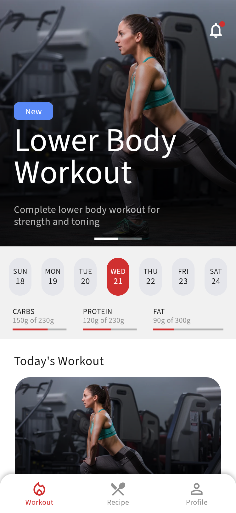
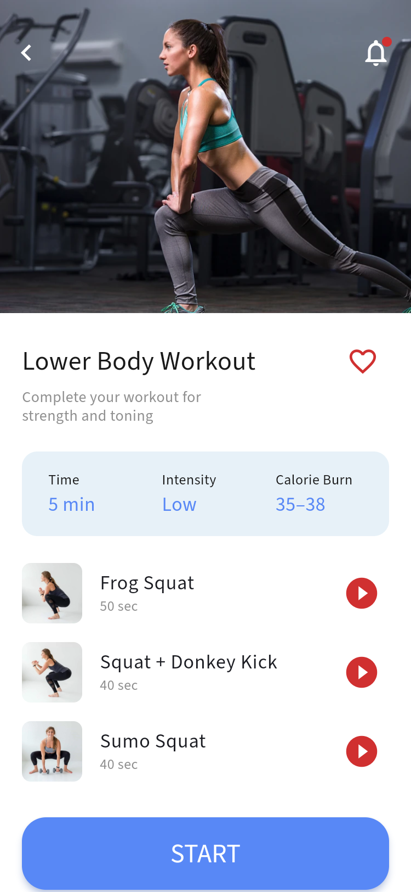
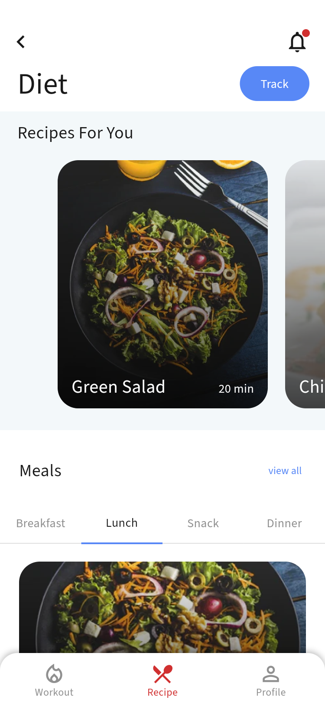
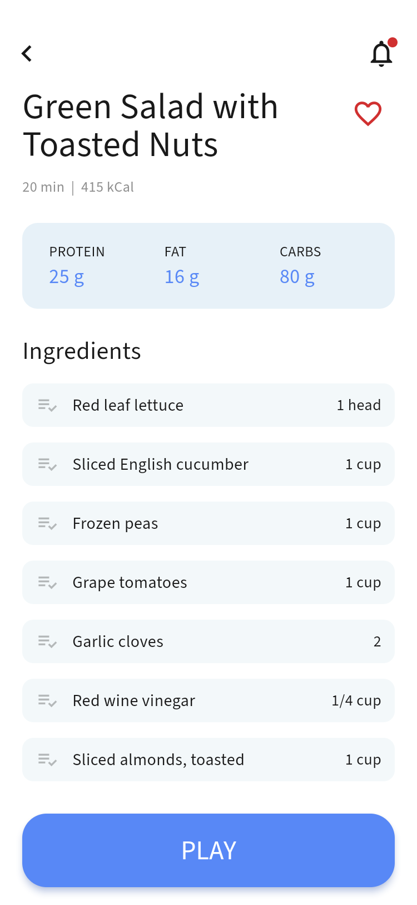
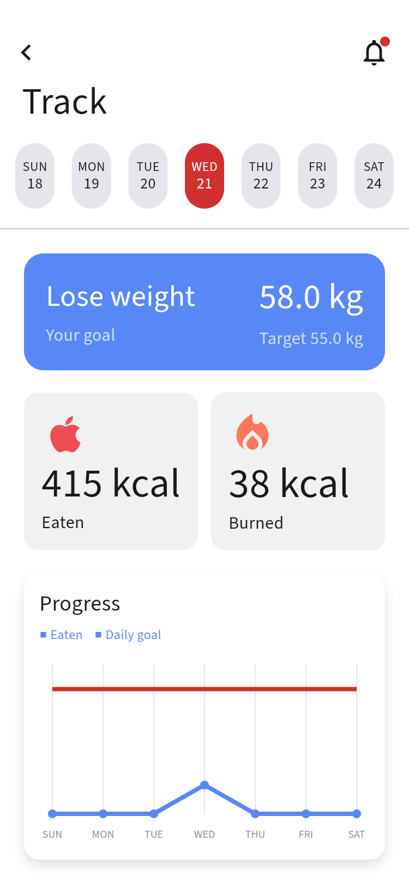
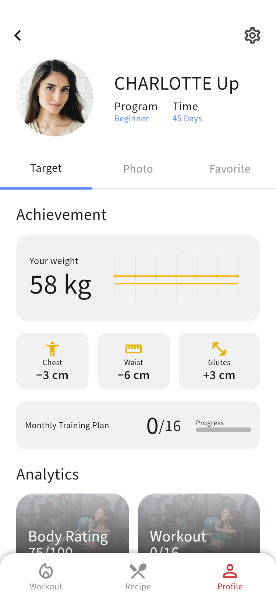
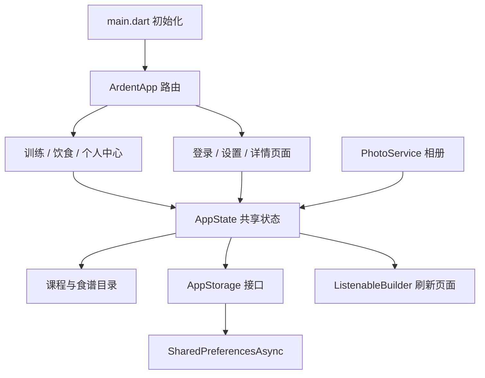

# Ardent 健身与饮食 App

根据 Pixso **Finess App UI_v1** 实现的 Flutter 应用，覆盖新手引导、训练、食谱、进度追踪和个人中心。页面使用 Flutter 原生布局与组件实现，图片素材离线打包。

设计来源：[Pixso 设计稿](https://pixso.cn/app/design/-t9CNAeHncECmks--YheKg)。页面和素材节点的对应关系见 [设计清单](docs/design_manifest.json)。

## 主要界面

以下为 Android 模拟器中运行应用后生成的截图。全部界面、长页面的后半部分以及完成状态见 [完整截图目录](docs/screenshots/README.md)。

| 训练首页 | 训练详情 | 饮食推荐 |
| --- | --- | --- |
|  |  |  |

| 食谱与食材 | 进度追踪 | 个人中心 |
| --- | --- | --- |
|  |  |  |

## 功能范围

| 模块 | 已实现的行为 |
| --- | --- |
| 引导与登录 | 三屏引导、登录/注册表单校验、密码显隐、找回密码入口、演示验证码校验 |
| 首次设置 | 目标选择、性别/年龄/身高/体重填写、饮食偏好多选 |
| 训练 | 可滚动首页、按难度筛选、课程详情、动作列表、准备倒计时、播放/暂停、切换动作、完成记录 |
| 饮食 | 推荐食谱轮播、按餐次筛选、食谱详情、食材勾选、烹饪步骤、饮食记录 |
| 追踪 | 按日期查看摄入和消耗、周记录图表、体重与目标展示 |
| 个人中心 | 成就、照片、收藏三个分栏，收藏联动，资料编辑，相册选图、预览和移除 |
| 设置 | 通知偏好、国家偏好、本地退出登录；界面语言沿用设计稿的英语 |
| 本地保存 | 登录演示状态、资料、目标、偏好、收藏、训练/饮食记录及个人照片 |

这是可交互的本地演示应用。登录、注册和验证码没有连接真实账号或短信服务；验证码为 **5555**，演示登录允许任意非空用户名和至少 6 位密码，密码不会保存。Facebook/Google 入口明确提示当前为演示。通知开关保存偏好，不发送推送。设计未提供视频，训练以图片与倒计时呈现，食谱播放入口提供逐步烹饪指南。文章文字为示例内容，体围与身体评分沿用设计示例，不代表测量或健康评估。

## 项目结构

```text
Ardent/
├── lib/
│   ├── main.dart                # 初始化、读取本地状态、恢复相册选择结果
│   ├── app.dart                 # 页面路由、三栏导航、状态订阅
│   ├── core/theme.dart          # 颜色、字体、输入框和标签样式
│   ├── data/
│   │   ├── catalog.dart         # 课程、动作、食谱与步骤数据
│   │   ├── app_state.dart       # 共享状态、业务操作、日期记录、写入队列
│   │   ├── storage.dart         # 存储接口及 SharedPreferences 实现
│   │   └── photo_service.dart   # 原生相册选择、大小限制与中断恢复
│   ├── features/
│   │   ├── onboarding.dart     # 引导及三步设置
│   │   ├── auth.dart           # 登录、注册、找回与验证
│   │   ├── workout.dart        # 首页、课程、计时、文章
│   │   ├── diet.dart           # 推荐、餐次、食谱、烹饪、追踪
│   │   └── profile.dart        # 个人中心、照片、设置、编辑
│   └── shared/
│       ├── widgets.dart        # 按钮、顶部栏、图片卡片、日期条、收藏
│       └── charts.dart         # Flutter Canvas 绘制图表
├── assets/
│   ├── images/                 # 从 Pixso 提取并优化的 WebP 素材
│   └── fonts/                  # Source Sans 3 字体及 OFL 许可
├── android/                    # Android 工程，最低 API 24
├── ios/                        # iOS 工程及照片用途说明
├── web/                        # Flutter Web 工程
├── test/                       # 状态、数据恢复、布局及计时测试
├── integration_test/           # 模拟器交互测试与截图场景
├── tool/                       # 截图保存和图片优化工具
├── docs/
│   ├── architecture.md         # 架构、状态、路由及扩展说明
│   ├── design_manifest.json    # Pixso 页面与素材节点清单
│   ├── reference/              # 原设计的 32 张页面参考图
│   ├── screenshots/           # 应用实际运行截图及索引
│   └── test_report.json        # 模拟器测试结果和截图清单
└── dist/                       # 可安装的 Android 包
```

## 架构

采用按功能组织的轻量分层结构，共享状态由 Flutter 自带的 `ChangeNotifier` 管理，通过 `ListenableBuilder` 刷新页面。仅引入相册和本地偏好存储两个业务依赖。



收藏、餐次记录和课程完成记录都从同一状态读取。饮食和训练按日期与条目 ID 保存，同一天重复记录同一条目不会重复累计；可切换日期查看。写入通过队列串行执行，避免快速操作覆盖新状态；保存失败会在界面上提示。

更多实现约定和后续接入方式见 [架构说明](docs/architecture.md)。

## 运行

本次开发环境为 Flutter **3.47.7**、Dart **3.13.5**。先安装 Flutter SDK，并准备 Android API 24 或更高版本的模拟器/设备。

```powershell
flutter pub get
flutter devices
flutter run -d <设备ID>
```

浏览器预览：

```powershell
flutter run -d chrome
```

iOS 工程已保留并配置照片用途说明；需要在 macOS 上使用 Xcode 编译、签名和验证。本次没有执行 iOS 真机或模拟器测试。

## 验证与重新截图

```powershell
flutter analyze
flutter test --concurrency=1
flutter drive --driver=tool/screenshot_driver.dart --target=integration_test/app_test.dart -d <Android设备ID>
```

最后一个命令会在 `docs/screenshots/` 保存实际运行的 PNG 截图，在 `docs/test_report.json` 保存交互测试结果。集成测试使用单独的存储键 `ardent_e2e_v1`，与正常应用数据隔离。单元与界面测试覆盖 375 和 320 逻辑像素的手机宽度。

2026-10-21 验证结果：静态分析无问题，8 项单元/界面测试通过，Android 模拟器集成测试通过，33 张运行截图已生成。测试和构建命令应依次执行，避免同时修改同一项目的构建缓存。

Release 安装包也已在模拟器安装验证，完成首次设置、饮食记录及两次冷启动，确认登录状态和饮食数据可恢复。结果见 [发布包验证记录](docs/release_report.json)。安装 Release 包后可用 `python tool/release_smoke.py` 重现这项检查。

构建 Android 安装包：

```powershell
flutter build apk --release --split-per-abi
```

已构建的测试安装包放在 `dist/`：普通较新安卓手机使用 [ARM64 安装包](dist/Ardent-arm64-v8a.apk)，本次模拟器使用 [x86_64 安装包](dist/Ardent-x86_64.apk)，旧 ARM 设备可用 [ARMv7 安装包](dist/Ardent-armeabi-v7a.apk)。这些是使用本地开发签名的 Release 构建。

## 设计还原与精简

- 原设计基准宽度为 375；长页面使用滚动布局，底部导航固定，输入时使用系统键盘和可滚动表单。
- 保留设计的红色主动作、蓝色次动作、浅蓝信息区、大图和圆角卡片。设计中的文字重叠、拼写错误和错误热量显示作了可用性修正。
- 原稿的 Myriad Pro 在本机不可用，使用相近的 [Source Sans 3](https://github.com/adobe-fonts/source-sans)；许可保留于 `assets/fonts/OFL.md`。
- 输入前后、长短页面与个人分栏共用实现，避免为每张设计图复制页面代码。
- 图片从约 16.3 MB 优化到约 1.2 MB；参考截图只用于文档，不打包进 App。
- 个人照片最多 5 张，每张限制 500 KB，仅保存在本机；原设计照片为内置示例。正式产品可将个人照片迁移到文件/数据库存储。

本地存储使用 [shared_preferences 官方插件](https://pub.dev/packages/shared_preferences)，相册选择使用 [image_picker 官方插件](https://pub.dev/packages/image_picker)。
